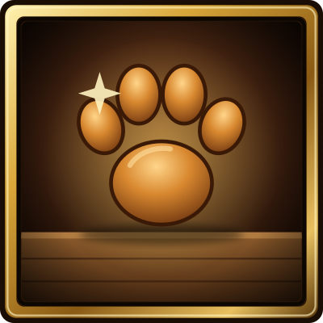
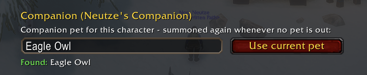

# Neutze's Companion

One companion pet per character for **World of Warcraft: Forever**, always out.

Type the pet you want on this character: `/nc Mechanical Squirrel`, or use Options > AddOns > Neutze's Pantry > Neutze's Companion. Whenever you have no pet out, it's summoned again: after login, loading screens, landing, dismounting, reviving and eating. A pet you call by hand is left alone.

- Never summons in combat, while stealthed, invisible or feigning death, mounted, on a flight path, casting or eating.
- Options: put the pet away in stealth (on by default), pause in dungeons, raids and battlegrounds.
- Writes a character macro **Companion** with the pet's icon, so you can call it from your bar.
- **Requires [Neutze's Pantry](https://github.com/neutze/wow-neutze-pantry)**: install it too. This add-on's options page sits under Neutze's Pantry. The field also shows at the bottom of `/np`.
- Turn off AutoCompanion if you use it, so the two don't fight.

## Install
CurseForge app, or download `NeutzeCompanion-v0.0.1.zip` from [Releases](https://github.com/neutze/wow-neutze-companion/releases) into `World of Warcraft/_forever_/Interface/AddOns/`.

Part of the **Neutze's** suite: [Pantry](https://github.com/neutze/wow-neutze-pantry) · [Stable](https://github.com/neutze/wow-neutze-stable) · [Macros](https://github.com/neutze/wow-neutze-macros)

## License
MIT
